# Using Fanela

This guide walks through Fanela 1.3.0 with the TV remote. If it isn't on your TV yet, start with the
[install guide](INSTALL.md).

You only need four buttons: the arrows, **OK**, **Back** and **Home**.

## 1. First start

The first time you open Fanela it asks three things, from the top.

1. **Language.** Choose English or Ελληνικά.
2. **Country.** It starts as the TV's own country. It decides where-to-watch (see [Where to watch](#where-to-watch))
   and which leagues come first. In a country Fanela has no TV partners for, you still get fixtures and scores.
3. **Your clubs.** A row of leagues sits above the clubs, football first, then basketball: your own country's league,
   the three UEFA cups, then the rest. Rest on a league for a moment, or press **OK**, to see its clubs. Press **OK**
   on each club you follow; a tick shows it's selected, and **OK** again removes it. The badge on a league is how
   many of its clubs you follow.

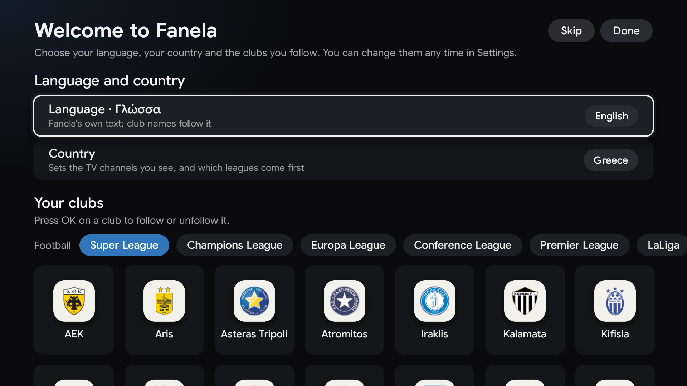

On TVs with the classic Android TV home screen, the TV asks whether to add each club's row to the home screen. Choose
**Add** (more about rows in section 6). Then press **Done** at the top right, and your fixtures appear within a few
seconds. **Skip** takes you straight to the app; you can pick your clubs later in Settings.

If you're updating from Fanela 1.1 or 1.0, nothing to do: your clubs and settings stay as they were. Updating from
1.0 also sets the country to Greece.

## 2. The main screen

Fanela has two layouts. **Club** is the one you start with; you can switch to **Matchday** in Settings > Appearance
(section 5). Both wear your club's colours, and clubs in white kits get a dark field.

### Club

One club at a time, in its colours.

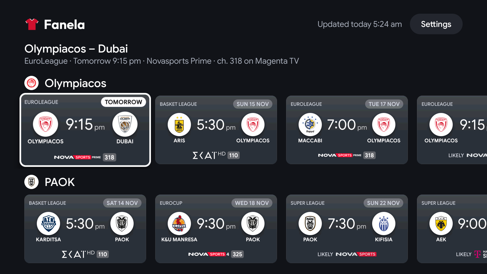

- **The rail on the left** lists the clubs you follow, each with its next kick-off. Press **left** to reach it, then
  **up** and **down** to switch clubs. The gear at the bottom opens **Settings**.
- **The large panel** is the club's next match, or the one being played: the competition, both crests, the day and
  kick-off time, and where to watch it.
- **Latest** shows the last two results, with **Win**, **Draw** or **Loss** for your club.
- **Fixtures** lists the matches after that: the date and time, the opponent and whether it's home or away, the
  competition and where to watch. A ball or a basketball marks the sport.

The top right shows the date and time, or **Updating…** while Fanela fetches new data. While the app is open it checks
live matches every 30 seconds, and a live match updates in place.

### Matchday

The next match on a stage, with rows of cards below: first the next and latest matches of all your clubs, then a row
for each club.

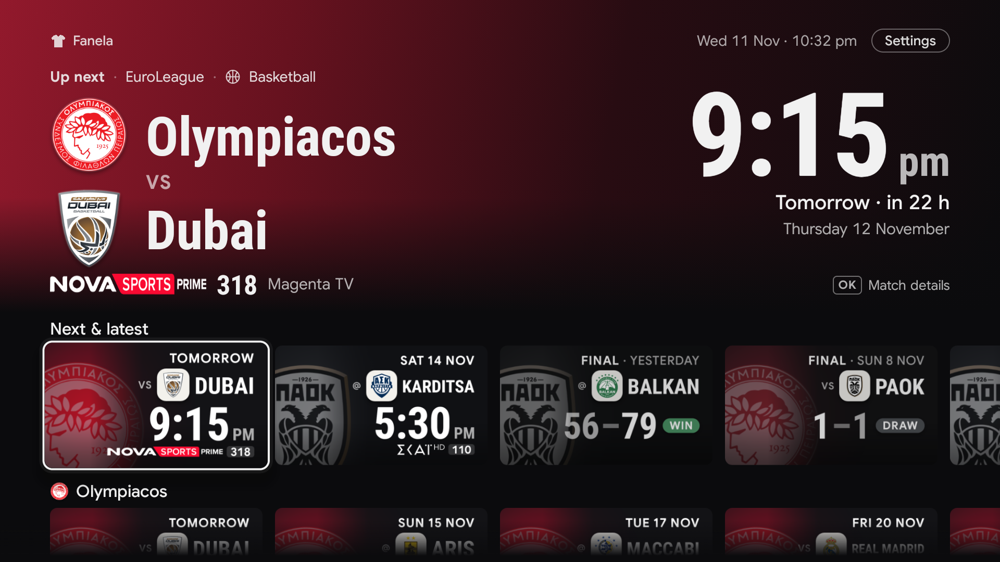

Use the arrows to move between cards. The stage at the top always shows the card you're on, with how soon it starts
("Tomorrow · in 22 h"). **Settings** is at the top right. The cards are drawn in the card style you chose (section 5).

### Reading a card

Every card style shows the same things, arranged its own way:

- **The day:** TODAY or TOMORROW when the match is near, otherwise the date.
- **The clubs:** the opponent's crest and name, with **VS** before a home game and **@** before an away one in
  Signature and Kit; Clean, Ticket and Clash show both clubs. Basketball games carry the clubs' own crests.
- **The kick-off time,** large. During a match a red **LIVE** pill appears with the minute or quarter and the score.
  Afterwards: the final score and **WIN**, **DRAW** or **LOSS** for your club.
- **Where to watch** (see below).
- **"Not updated"** means Fanela couldn't refresh that match for more than 6 hours, usually because the TV was
  offline. The card shows the last information it had.

Unusual matches say what's going on: awaiting a time, delayed, suspended, abandoned or postponed.

### Where to watch

In Greece:

- **A channel logo with a number** (for example Novasports Prime 318): a TV guide has listed the match, and the number
  is the channel on Magenta TV.
- **"Likely" and a channel:** no guide has listed it yet. Fanela shows the channel that holds the home team's TV
  rights. Check your provider's guide closer to the day.
- **"Channel: to be announced":** nothing is known yet.

In other countries:

- **"Likely" and one or two names** (for example Sky Sports and TNT Sports in the UK): the channels or services that
  hold this competition's rights in your country this season. One match can still be elsewhere, so your provider's
  guide has the last word.
- **"Check your provider's guide":** Fanela has no official list of this competition's TV partners for your country.
  Some leagues, such as the Super League and the Saudi Pro League, don't publish one.

## 3. Match details

Press **OK** on any match to see it on its own.

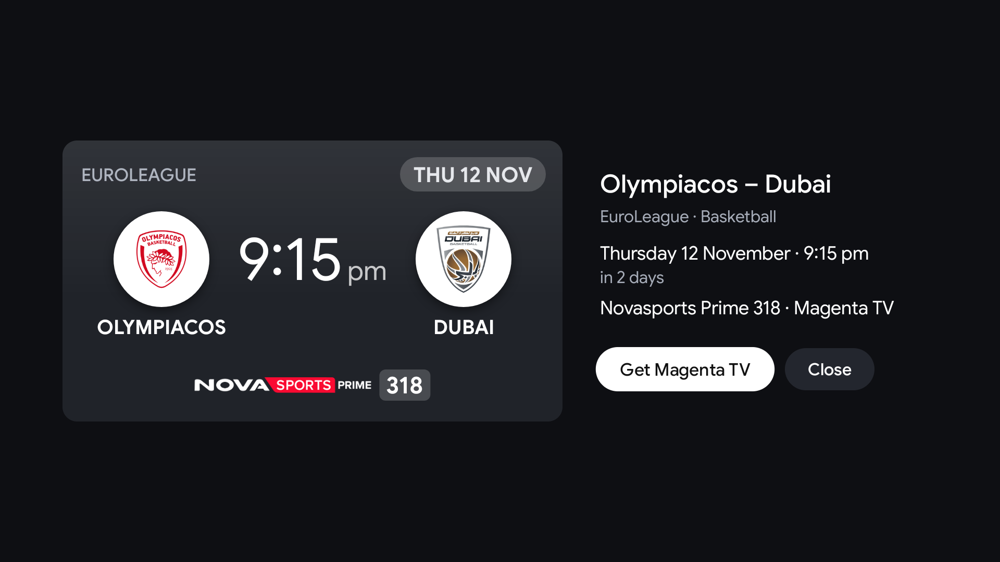

The match screen shows the competition and whether it's a home or away game, both crests, how soon it starts
("Tomorrow", "In 9 days") with the time and the full date, and where to watch it, with a line saying where that comes
from. At the bottom: your club's last five results in that competition, and the date of the return leg when there is
one.

If the channel's app (Magenta TV or SPORT FM TV) is installed, **Open Magenta TV** takes you straight there. If it
isn't, **Get Magenta TV** opens its page on Google Play. Press **Back** to return.

When the channel is only "likely", the screen says so and explains why:

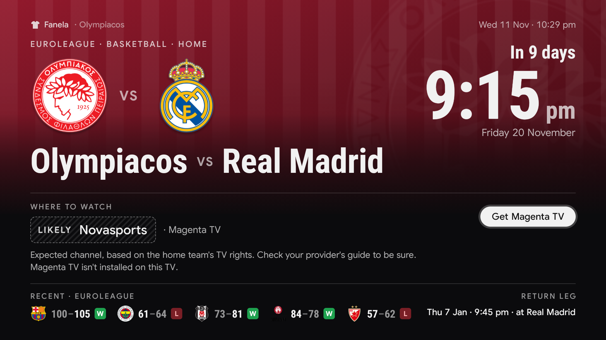

Outside Greece it shows the season's rights holders and where that comes from, or says plainly that Fanela has no
list for your country:

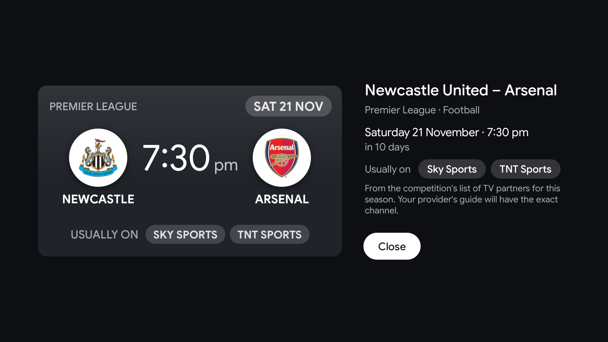

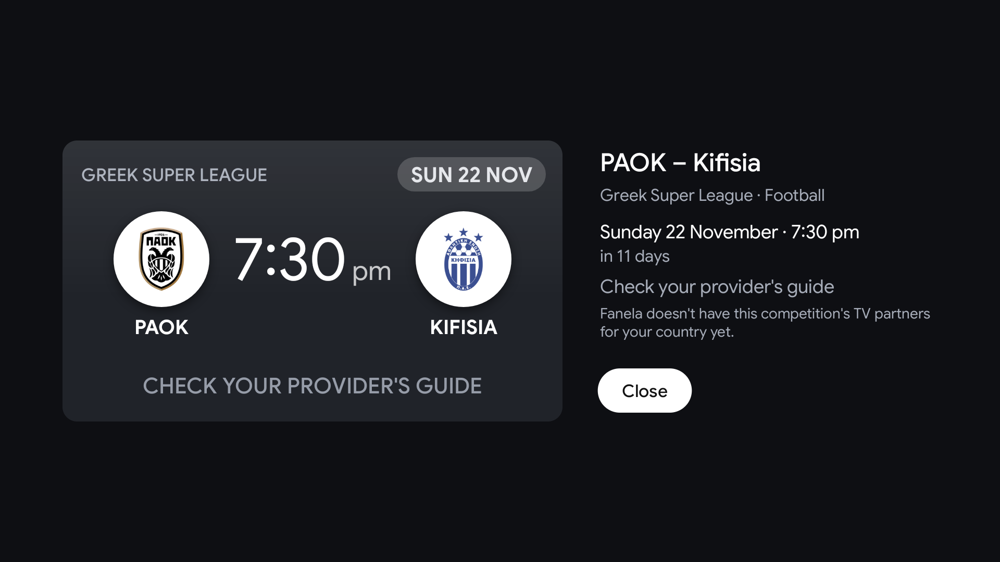

## 4. Settings

In the Club layout, press **left** to reach the rail and go down to the gear at the bottom. In Matchday, **Settings**
is at the top right. Then press **OK**.

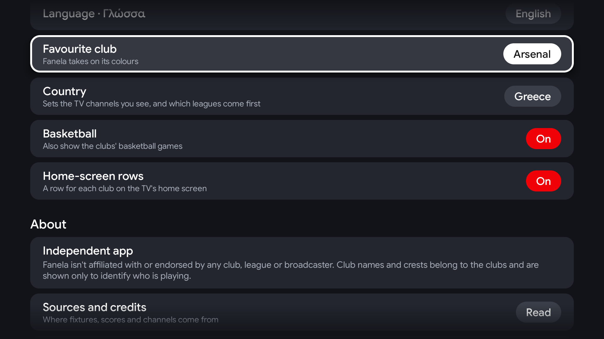

- **Your clubs and sports.** The same leagues and grid as the first start, with Formula 1 and UFC at the end under
  **More sports** (section 7). Follow or unfollow at any time. Changes are saved straight away.
- **Language.** Switches between English and Greek. Club names switch too, in every league.
- **Favourite club.** The club whose colours Fanela wears: the Matchday screen, the shirt in the logo, and the app's
  tile on the TV. Until you choose one, it's the first club you follow. The tile changes after you leave the app; on
  some TVs it shows once the home screen reloads.
- **Country.** Sets which TV partners you see and which leagues come first. The TV's own country is at the top, the
  current one has a tick.

  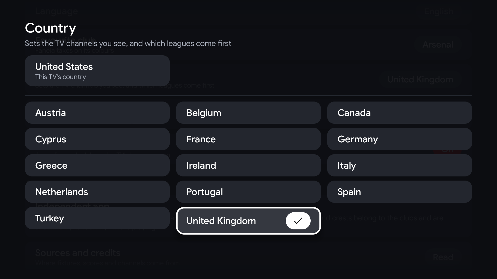

- **Basketball.** On by default. Turn it off if you only want football.
- **Home-screen rows.** Puts a row for each club on the TV's home screen (see section 6). If the TV is hiding one of
  them, it's listed right under this switch with an **Add** button. On TVs whose home screen doesn't show rows, such
  as Google TV, this line says so.
- **Appearance.** Card style, app layout and scores on the home screen (next section).
- **About.** Where the data comes from (with the date each competition's TV partners were last checked), the privacy
  policy, the version, and **Status**: when the data was last refreshed, and which club, if any, hasn't updated for
  a while.

  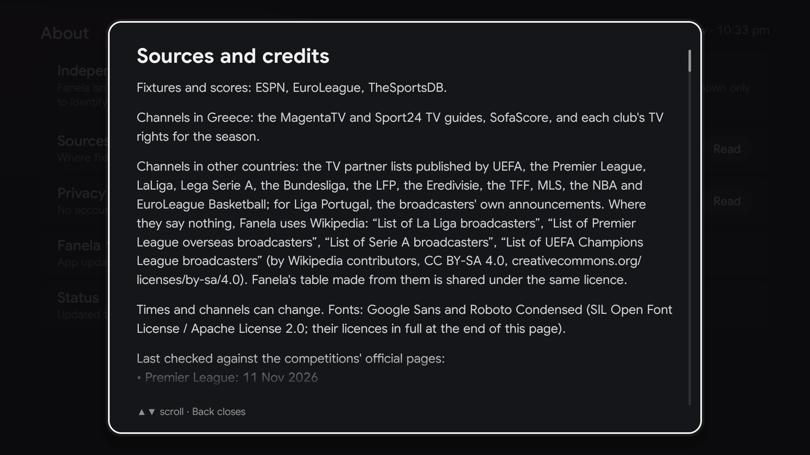

## 5. Appearance

Settings > Appearance changes how Fanela looks.

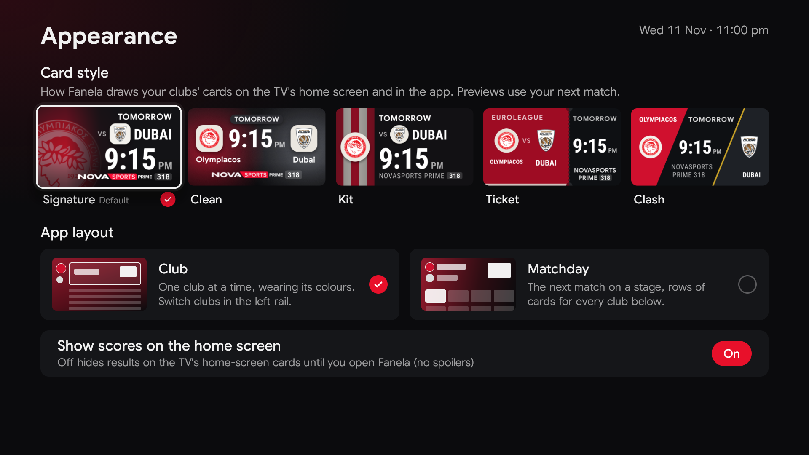

- **Card style.** Five styles for the cards on the TV's home screen and in the app. The previews are live, drawn
  with your next match, so you see exactly what you'll get.
  - **Signature** (the default): your club's colours with its crest as a large watermark.
  - **Clean:** calm and minimal, both clubs side by side.
  - **Kit:** your club's shirt down the side of the card, stripes included.
  - **Ticket:** a match ticket, with the channel on the stub.
  - **Clash:** both clubs' kit colours meeting on a diagonal.

  Choose one with **OK**. The home-screen rows are redrawn in the new style straight away.

  | | |
  |---|---|
  | 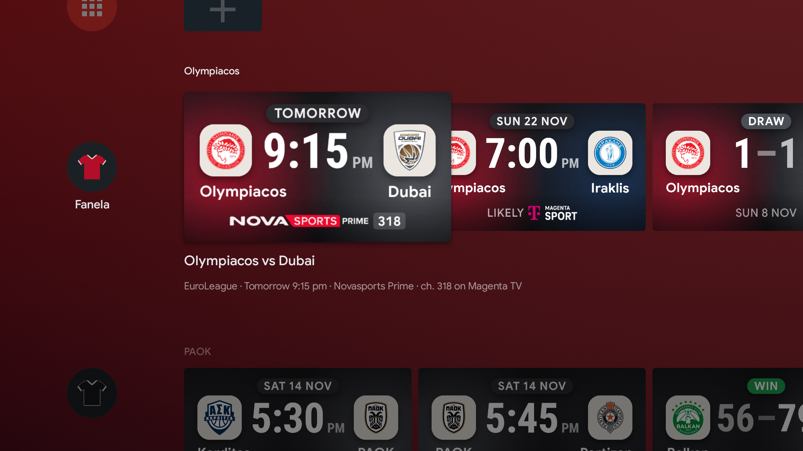 | 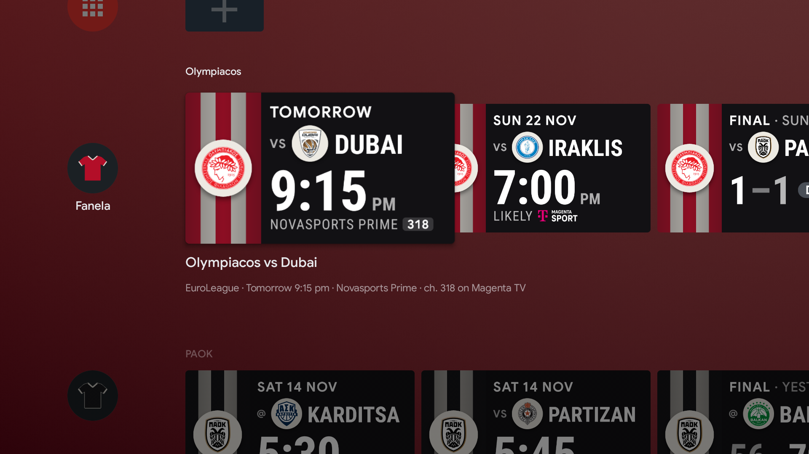 |
  | 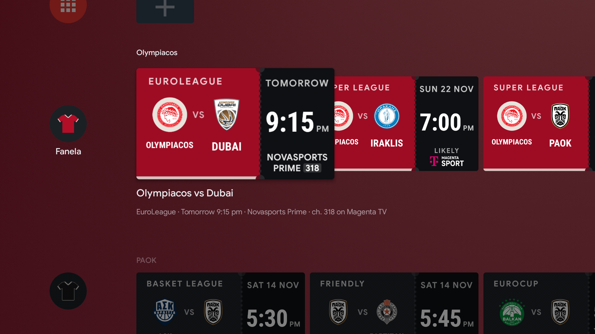 | 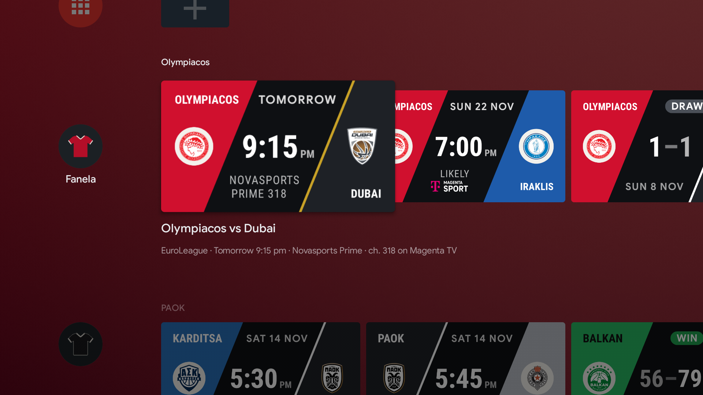 |
- **App layout.** **Club** (one club at a time, switch clubs in the left rail) or **Matchday** (the next match on a
  stage, rows of cards below).
- **Show scores on the home screen.** Turn it off to keep results off the home-screen cards and the titles the TV
  shows, for matches you'll watch later; the cards say LIVE or FINAL without the numbers. Fanela itself still shows
  the football and basketball scores; Formula 1 and UFC results stay hidden in the app too (section 7). On TVs whose
  home screen doesn't show rows, this line says so instead.

## 6. Rows on the TV home screen

On TVs with the classic Android TV home screen, Fanela can add one row per club (and one per sport, section 7) to
the home screen. Each club's row has the Fanela shirt in that club's colours at its side, and cards in your card
style, drawn large enough to read from across the room. Resting on a card shows the match and where to watch it under the row.

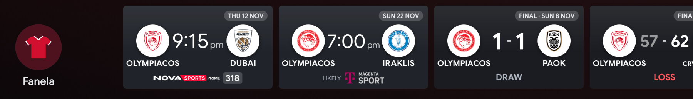

The rows update every 15 minutes when a match is close, and less often otherwise. Press **OK** on a card to open that
match in Fanela. When you stop following a club, its row goes at once.

If you hid a row by mistake, go to Settings > Home-screen rows and press **Add** next to it. You can also manage rows
from the TV itself: Home > Customise channels.

Google TV and most operator launchers don't show rows from apps. On those, open Fanela to see your fixtures.

## 7. Formula 1 and UFC

Fanela can follow Formula 1 and UFC next to your clubs. Football works as before until you follow one of them.

**Following.** In Settings > Your clubs and sports, go right along the row of leagues to **More sports**, then pick
**Formula 1** or **UFC** and press **OK** on its tile. Both have optional choices under the tile:

- **Formula 1:** up to two drivers or teams. The cards then put your driver or team first, in the team's colour.
- **UFC:** **All** events or **Numbered only** (UFC 334, UFC 335 …), and the fighters you follow, picked from the
  next cards. A followed fighter's bout becomes the card's headline on any event.

**Rows.** Each sport gets its own row on the TV's home screen, with the next session or fight card and the latest
result. If the TV doesn't show the row, add it from Home > Customise channels.

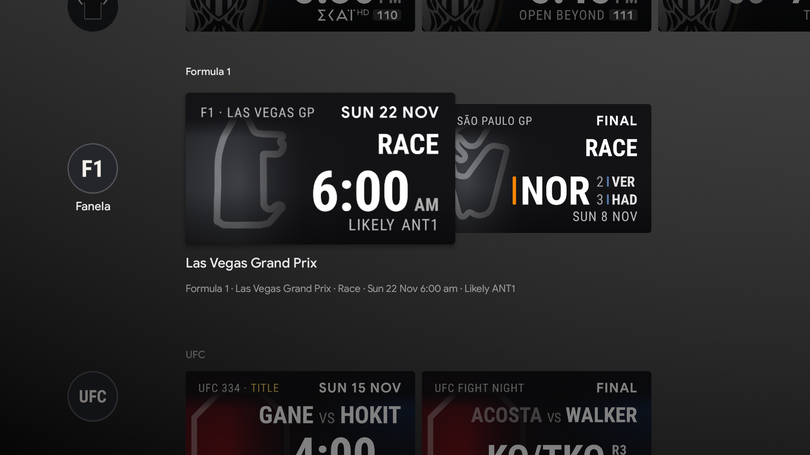

**In the app.** In the Club layout, Formula 1 and UFC sit in the rail after your clubs: the next session or main card
at your time and where to watch it, the latest result and the standings, then the rest of the weekend or the next
events. In Matchday each sport has its own row of cards. Press **OK** on either to open its screen:

- **The race weekend:** the circuit, every session at your local time with where to watch it, and the drivers'
  championship (**right** for the constructors', **left** to go back). After a session, its classification. **OK** on a
  session opens the channel's app.

  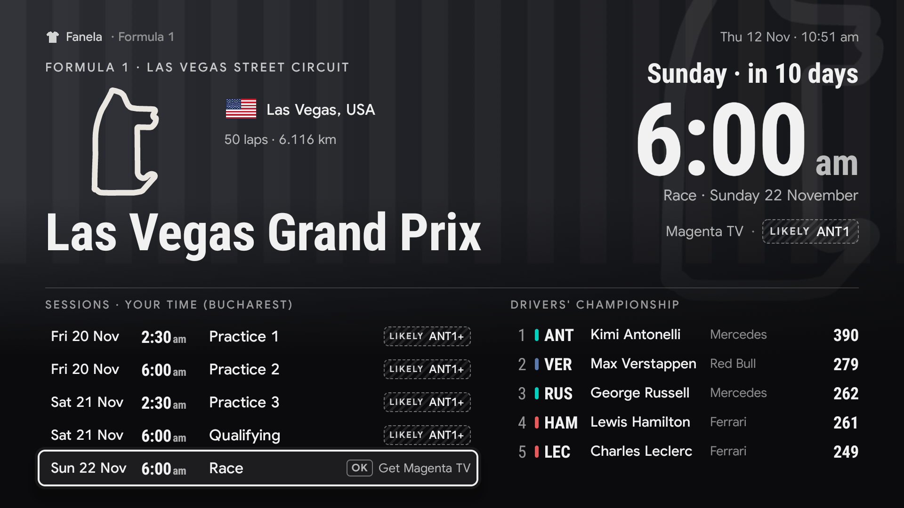

- **The fight card:** every bout from the main card down to the early prelims, with records, flags and the channel
  for each part, and how each fight ended once it's over. To follow a fighter, hold **OK** on his bout, use **left**
  or **right** to choose between the two, and press **OK**.

  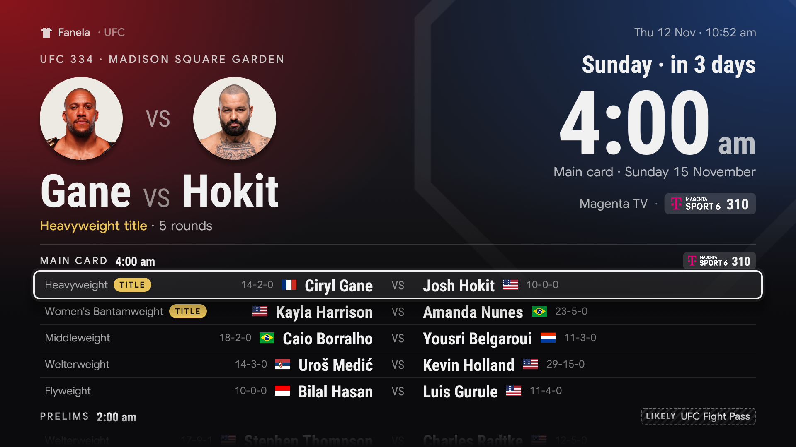

All five card styles draw Formula 1 and UFC. When **Show scores** is off (section 5), the results stay hidden in these
screens too: no podium, winner, method or standings.

While a session or a fight is live, Fanela says **LIVE** with the session or the bout on stage. The lap of a race and
the round of a fight will follow in a later update.

## 8. In Greek

Everything, including team names, competitions and dates, switches to Greek when you choose Ελληνικά, and times are
always on the 24-hour clock. Clubs from other leagues have their Greek names too ("Άρσεναλ", "Μπάγερν",
"Γκλάντμπαχ"); MLS, Brazilian, Argentine and Saudi clubs keep their own.

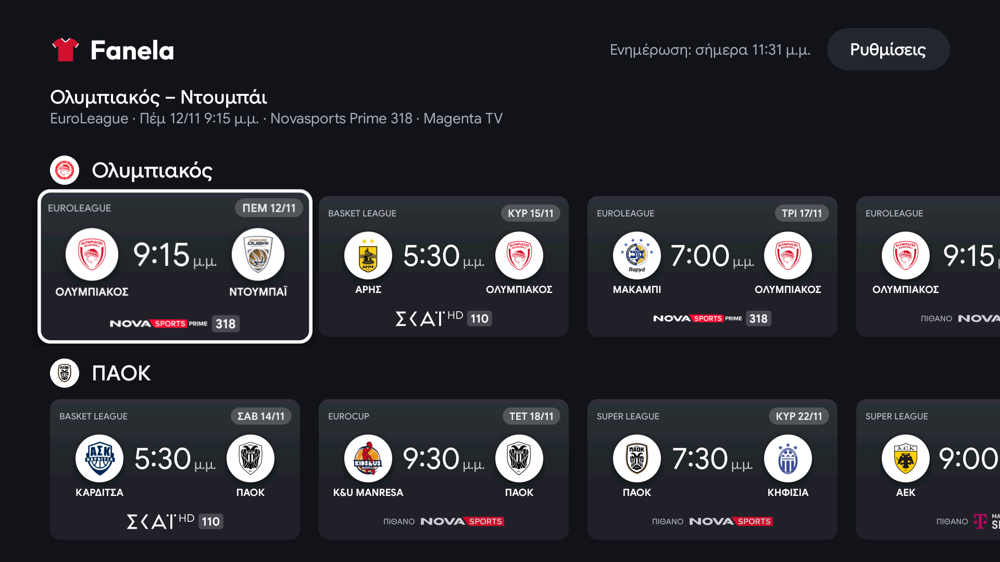

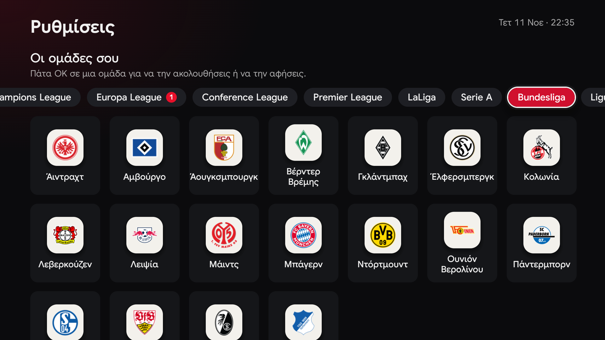

## 9. Updating

Fanela doesn't update itself. When a new version is out, download its APK from the
[Releases page](https://github.com/AlexisKaravitis/fanela-tv/releases) and install it the same way you installed the
first one. Android installs it over the old version and keeps your clubs and settings.

## Something not right?

The [install guide](INSTALL.md#if-something-isnt-right) has a table of common problems, such as fixtures not loading,
a channel that looks wrong, or a missing row.
